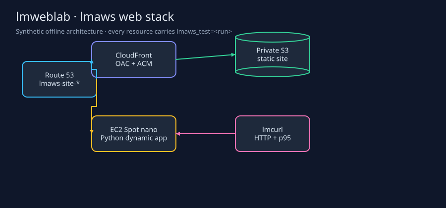
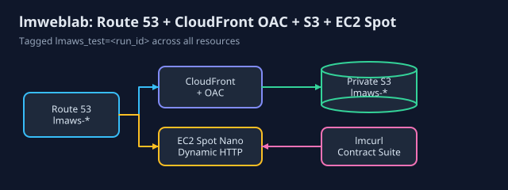
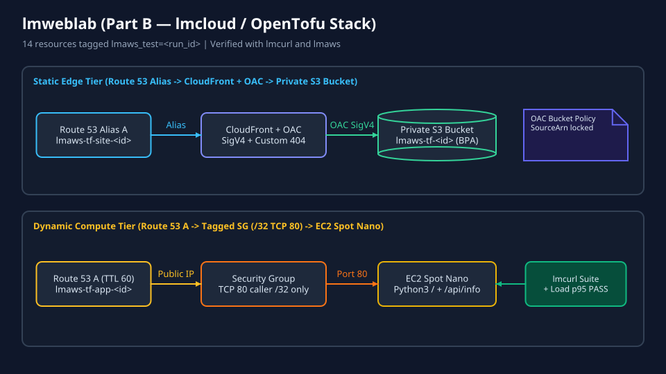

# lmweblab



`lmweblab` is a pictures-first integration test for the same tagged web stack implemented with lmaws and lmcloud. The lmaws driver provisions a private S3 site, CloudFront, Route 53 records, and a disposable tagged nano web server; lmcurl performs the HTTP assertions and p95 load check.

| Picture | Runnable example |
| --- | --- |
|  | `lmctl https://raw.githubusercontent.com/lmctl-ai/lmweblab/main/lmaws/report.lms` |
|  | `lmctl https://raw.githubusercontent.com/lmctl-ai/lmweblab/main/shared/site/render_banner.lms` |
|  | `lmctl https://raw.githubusercontent.com/lmctl-ai/lmweblab/main/lmcloud/all.lms` |

Offline runs are the local gate and cost `$0.00`. They use synthetic fixtures and always execute teardown. Live runs require `AWS_PROFILE=lmaws`, `LMWEBLAB_DOMAIN`, and `LMWEBLAB_LIVE=1`; names use `lmaws-site-<run>` and `lmaws-app-<run>`, and taggable resources carry `lmaws_test=<run>`. DNS names and OAC creation proofs bind the remaining resources to the run. The default cap is `$0.10` with a `$0.25` hard ceiling. Never use an administrator profile.

```sh
lmctl lmaws/web_stack.lms all --offline
lmctl lmaws/web_stack.lms all --offline --phase2
```

The dynamic app serves escaped query echo, request counters, timestamps, hostname, and `/api/info`. Teardown is available separately as `lmctl lmaws/down.lms <run-id>` and verifies the owned state before deletion.


The live driver needs lmaws v0.1.16 or newer, or the current development host on `PATH`. Clone this repository before running the lifecycle driver; the gallery report URL is self-contained. Set `AWS_PROFILE=lmaws`, `AWS_REGION=us-east-1`, and `LMWEBLAB_DOMAIN` to the existing public hosted-zone domain. Committed examples use `example.com` as a placeholder.

```sh
lmctl lmaws/web_stack.lms all --live --phase2
lmctl lmaws/web_stack.lms status --live --run-id RUN_ID
lmctl lmaws/web_stack.lms down --live --run-id RUN_ID
bash test.sh
```

HTTP checks include bounded readiness polling, exact status/content checks, HTML escaping, JSON schema, monotonic counters/timestamps, and a ten-request load check. Timings are milliseconds. The user-data server schedules termination, and standard CPU-credit mode avoids surplus-credit charges. Live state, endpoint URLs and raw evidence stay in ignored private files; committed pictures use synthetic fixtures.

[Importable per-step recipes](lmaws/recipes/README.md) support reuse from a local path or a raw URL. [Shared test contracts](shared/README.md) describe the lmcurl-only HTTP tests.

Live Part A passed both phases: p95 **391 ms HTTP** and **152 ms HTTPS**. The successful estimate was **$0.00108**; the complete campaign estimate was **$0.00514**. A fresh lmaws process verified **zero active leftovers** across all seven attempt namespaces. [Timings, cost basis and tool comparison](compare/RESULTS.md).

[lmaws v0.1.16 release](https://github.com/lmctl-ai/lmaws/releases/tag/v0.1.16): five native binaries, verified checksums, and a fresh-cache offline install proof.


The [scenario catalog](scenarios/README.md) adds independent lmaws implementations of 01 (static site), 02 (dynamic nano), 03–06 (live-verified Lambda patterns), and 11 (weighted DNS). The live weighted and Lambda campaigns passed; every attempt namespace was independently empty after the required settlement window; [numeric results and limits](scenarios/RESULTS.md) distinguish real measurements from fixtures. Run from each `scenarios/NN-name/lmaws/` directory with `lmctl all.lms --offline`; new APIs currently require a source-built lmaws on PATH.
