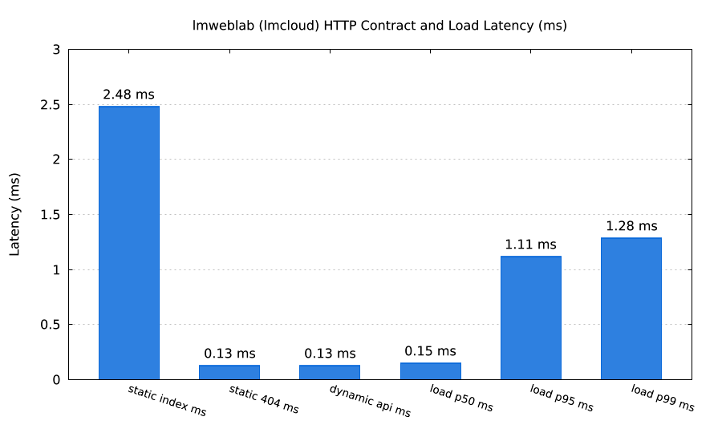

# lmweblab — Part B (`lmcloud` / OpenTofu Stack)

OpenTofu configuration and `lmscript` lifecycle drivers (`up.lms`, `test.lms`, `down.lms`, `all.lms`, `status.lms`, `validate.lms`) executed in-process through `lmcloud` (`>= v0.1.11`) and verified with `lmcurl` and `lmaws`.

| OpenTofu Stack Architecture (`lmdraw`) | HTTP Contract & Load Latency (`lmplot`) |
| --- | --- |
|  |  |
| `lmctl https://raw.githubusercontent.com/lmctl-ai/lmweblab/main/lmcloud/test.lms` | `lmctl https://raw.githubusercontent.com/lmctl-ai/lmweblab/main/lmcloud/all.lms` |

## Stack Resources (`lmaws_test = <run_id>`)

All resources are scoped to `us-east-1`, named with the `lmaws-tf-*` prefix, and tagged at creation with `lmaws_test = var.run_id` (via both provider `default_tags` and explicit resource tags):

1. **Private S3 Static Origin (`aws_s3_bucket.site`, `aws_s3_bucket_public_access_block.site`, `aws_s3_object.site_assets`, `aws_s3_bucket_policy.site`)**:
   - Bucket name: `lmaws-tf-<run_id>` with `force_destroy = true` and all four Block Public Access settings enabled.
   - Uploads `index.html`, `about.html`, `style.css`, `banner.png` (rendered with `lmdraw`), and `404.html` from `../shared/site/`.
   - Bucket policy grants `s3:GetObject` and `s3:ListBucket` strictly to `cloudfront.amazonaws.com` conditioned on `AWS:SourceArn = aws_cloudfront_distribution.site.arn`.
2. **CloudFront Distribution + Origin Access Control (`aws_cloudfront_origin_access_control.site`, `aws_cloudfront_distribution.site`)**:
   - SigV4 `s3` Origin Access Control (`lmaws-tf-oac-<run_id>`).
   - Default root object `index.html`, gzip compression enabled, custom `404` error page (`/404.html`), `PriceClass_100`, tagged `lmaws_test = <run_id>` at creation.
   - Phase 1 (`enable_acm = false`): serves HTTP/HTTPS on the CloudFront domain and creates the Route 53 alias record `lmaws-tf-site-<run_id>.<domain>`.
   - Phase 2 (`enable_acm = true`): requests an ACM certificate (`aws_acm_certificate.site`) in `us-east-1`, creates the DNS validation CNAME (`aws_route53_record.site_cert_validation`), attaches the validated certificate (`aws_acm_certificate_validation.site`) with `aliases = ["lmaws-tf-site-<run_id>.<domain>"]`, and enforces `redirect-to-https`.
3. **EC2 Spot Nano Dynamic Server (`aws_security_group.app`, `aws_instance.app`)**:
   - Tagged security group `lmaws-tf-sg-<run_id>` allowing inbound TCP port `80` **only** from the caller's `/32` public IPv4 (detected via `lmcurl` against `https://checkip.amazonaws.com`).
   - One-time Spot `t4g.nano` (or `t3.nano`) instance with 8 GiB `gp3` root volume (`delete_on_termination = true`), tagged on both `tags` and `volume_tags` with `lmaws_test = <run_id>`.
   - User-data (`../shared/userdata/user_data.sh`) starts a Python 3 standard-library HTTP server on port 80 serving `/` (current UTC timestamp, hostname, atomic request counter, HTML-escaped query echo, and `run_id`) and `/api/info` (JSON contract).
4. **Route 53 Records (`aws_route53_record.site_alias`, `aws_route53_record.app`)**:
   - `lmaws-tf-site-<run_id>.<domain>` (`A` Alias to CloudFront distribution).
   - `lmaws-tf-app-<run_id>.<domain>` (`A` record, TTL `60`, to Spot instance public IPv4).

## Scripts

```sh
# Offline validation (fmt_check, init, validate, Phase 1 & Phase 2 mock plans)
lmctl lmcloud/validate.lms

# Offline end-to-end run (up -> test -> down + picture reports)
lmctl lmcloud/all.lms

# Live AWS run (requires AWS_PROFILE=lmaws and LMWEBLAB_DOMAIN)
AWS_PROFILE=lmaws LMWEBLAB_DOMAIN=example.com lmctl lmcloud/all.lms --live
```

## Measured Live Runs (`AWS_PROFILE=lmaws`)

| Run ID | Phase | Resources | `up.lms` (`init` / `plan` / `apply`) | `test.lms` (`wait` / `suite`) | Load `p50` / `p95` | `down.lms` (`destroy` / `audit`) | Leftovers | Est. Cost |
| --- | --- | ---: | ---: | ---: | ---: | ---: | ---: | ---: |
| `tfp1r2` | Phase 1 (HTTP) | 14 | `232.35 s` (`0.97 s` / `3.51 s` / `227.87 s`) | `3.83 s` (`0.60 s` / `3.07 s`) | `132.04 ms` / `175.37 ms` | `281.03 s` (`276.16 s` / `4.86 s`) | **`0`** | `$0.0040` |
| `tfp2r2` | Phase 2 (ACM + HTTPS) | 17 | `274.27 s` (`0.86 s` / `3.98 s` / `269.43 s`) | `4.53 s` (`0.52 s` / `3.91 s`) | `129.23 ms` / `177.81 ms` | `328.76 s` (`314.80 s` / `13.96 s`) | **`0`** | `$0.0040` |

See [`../scenarios/COMPARE.md`](../scenarios/COMPARE.md) and [`../scenarios/RESULTS.md`](../scenarios/RESULTS.md) for full engineering notes and scenario catalog results.
