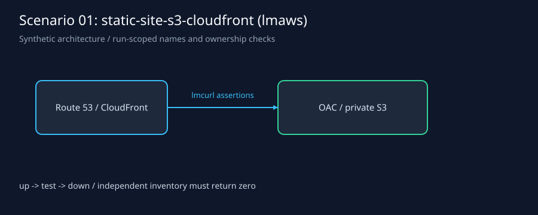
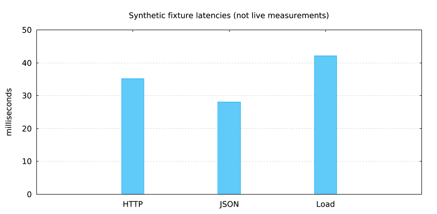

`lmctl report.lms`

# static-site-s3-cloudfront: lmaws engine

Run from this directory. `lmctl all.lms --offline` executes fixture-backed provider steps and real loopback HTTP assertions, then tears down. The five lifecycle scripts have editable CONFIG sections. Compiler 0.2.426 uses uppercase `let`; newer compilers may use `const`. No list interpolation is required.

```sh
lmctl up.lms --offline
lmctl test.lms --offline
lmctl status.lms --offline
lmctl down.lms --offline
# Guaranteed cleanup after a failed deployment or test:
lmctl all.lms --offline
```

For live execution set `AWS_PROFILE=lmaws`, `AWS_REGION=us-east-1`, `LMWEBLAB_DOMAIN` to the authorized zone, and a fresh hexadecimal `LMWEBLAB_RUN_ID`. Then use `lmctl all.lms --live`. State, provider identifiers, raw reports and cost receipts stay in ignored `.lmweblab-local/`. Never select admin. `down.lms` is independently rerunnable.

| Setting | Default | Meaning |
|---|---|---|
| REGION | us-east-1 | Session region constraint |
| DOMAIN | example.com | Override with LMWEBLAB_DOMAIN for live DNS |
| NAME_PREFIX | lmaws | Session name constraint |
| INSTANCE_TYPE | t4g.nano | Nano only; bounded capacity fallback |
| REQUEST_TIMEOUT_MS | 10000 | HTTP timeout |
| SAMPLES_PER_STEP | 20 | Scenario 11 binomial sample count |
| COST_CAP_USD | 0.10 | Cumulative run estimate cap; host ceiling 0.25 |
| ENABLE_HTTPS | false | Set LMWEBLAB_ACM=1 or --acm |

The current guarded host fixes DNS TTL at 60 seconds, HTML cache at 300 seconds, and assets at 3600 seconds. These are host constraints, not editable script settings. Static custom aliases require an ACM certificate even for HTTP; this engine prepares one before creating CloudFront. The dynamic-only deployment does not create S3, CloudFront or ACM.

Estimated live cost is below $0.01 for a minutes-long run; actual price-table estimates appear in private receipts. Offline cost is $0.00. Nano + public IPv4 + 8 GiB gp3 are charged while alive. Results and measured timings are recorded in [../../RESULTS.md](../../RESULTS.md), separately from the synthetic pictures below.



`lmctl report.lms`

All HTTP uses lmcurl. Scenario 01 tests static content, exact 404, cache headers, gzip and aliases; 02 tests dynamic counters, time, JSON schema, escaping and load p95. Scenario 11 adds 90/10 → 50/50 → 0/100 weighted records, distinct DoH ECS subnets to avoid resolver caching, and an outward-rounded three-sigma binomial band. Zero static weight must yield zero static hits. Down checks the durable ledger and a fresh independent lmaws inventory.
