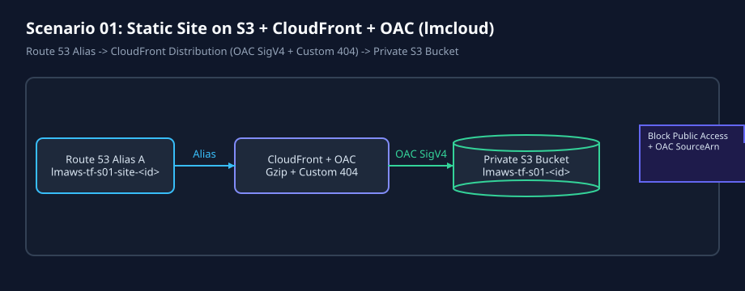
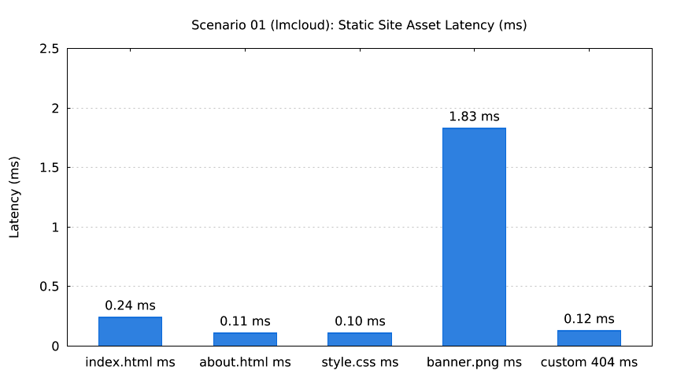

# Scenario 01: Static Site on S3 + CloudFront + Route 53 Alias + OAC (`lmcloud`)



`lmctl scenarios/01-static-site-s3-cloudfront/lmcloud/all.lms`



`lmctl scenarios/01-static-site-s3-cloudfront/lmcloud/test.lms`

## Overview

Deploys a private S3 static site fronted by CloudFront Origin Access Control (OAC SigV4), custom 404 error routing (`/404.html`), gzip compression, and a Route 53 alias `A` record (`lmaws-tf-s01-site-<run_id>.<domain>`), with optional ACM DNS-validated TLS certificate (`--acm`).

- **Typical cost**: `$0.0000` offline; `~$0.0005` per live run (S3 + CloudFront + Route 53 requests; ACM certificate is free).
- **Typical time**: `~2.1s` offline (`init` + `validate` + `plan` + mock `lmcurl` + `lmdraw`/`lmplot`); `~3.8m` live deploy + `~4.5m` live teardown (bounded by CloudFront edge propagation).

## Configuration Constants (`# === CONFIG ===`)

Every `.lms` script starts with editable constants spliced into `_dsl_` blocks via `${NAME}`:

| Constant | Default | Purpose |
| --- | --- | --- |
| `REGION` | `"us-east-1"` | Target AWS region |
| `DOMAIN` | `getenv("LMWEBLAB_DOMAIN", "example.com")` | Route 53 hosted zone domain |
| `NAME_PREFIX` | `"lmaws"` | Mandatory resource naming prefix |
| `SCENARIO_SLUG` | `"s01"` | Scenario identifier in resource names |
| `HTML_CACHE_SECONDS` | `300` | `Cache-Control: public, max-age=...` for HTML |
| `ASSET_CACHE_SECONDS` | `3600` | `Cache-Control: public, max-age=...` for CSS/PNG |
| `PRICE_CLASS` | `"PriceClass_100"` | CloudFront edge price class |
| `DEFAULT_ROOT_OBJECT` | `"index.html"` | CloudFront default root object |
| `ERROR_PAGE_PATH` | `"/404.html"` | Custom 404 error response path |
| `ENABLE_ACM` | `false` (`--acm` for `true`) | Provision ACM certificate + HTTPS redirect |

## Commands

Run from inside `scenarios/01-static-site-s3-cloudfront/lmcloud/` (or from repo root):

```bash
# Offline validation + mock contract tests + diagram/chart generation ($0.0000)
cd scenarios/01-static-site-s3-cloudfront/lmcloud
lmctl up.lms
lmctl test.lms
lmctl down.lms
# Or full lifecycle with guaranteed teardown:
lmctl all.lms

# Live AWS run (AWS_PROFILE=lmaws only)
AWS_PROFILE=lmaws LMWEBLAB_DOMAIN=example.com LMWEBLAB_LIVE=1 LMAWS_LIVE=1 lmctl all.lms --live --acm --run-id s01r01
```
