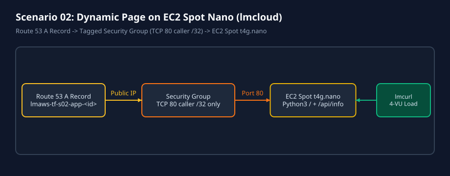
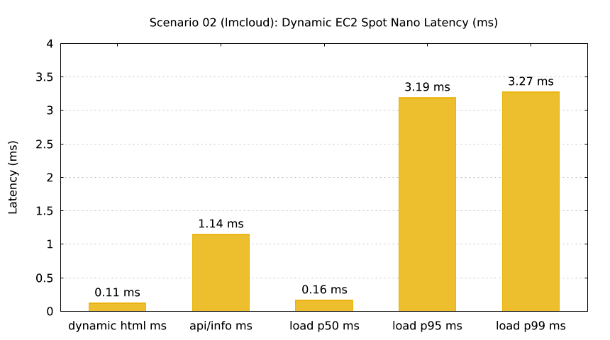

# Scenario 02: Dynamic Page on EC2 Spot Nano + Route 53 A Record (`lmcloud`)



`lmctl scenarios/02-dynamic-page-spot-nano/lmcloud/all.lms`



`lmctl scenarios/02-dynamic-page-spot-nano/lmcloud/test.lms`

## Overview

Deploys a one-time EC2 Spot `t4g.nano` instance (8 GiB `gp3`, `DeleteOnTermination=true`) running a zero-dependency Python 3 dynamic HTTP server (`/` with HTML-escaped query echo + `/api/info` JSON counter/timestamp/hostname endpoint), guarded by a tagged security group allowing inbound TCP 80 from the caller's `/32` IPv4 only and published via a Route 53 `A` record (`lmaws-tf-s02-app-<run_id>.<domain>`).

- **Typical cost**: `$0.0000` offline; `~$0.0035` per live run (Spot `t4g.nano` minutes + 8 GiB `gp3` + public IPv4).
- **Typical time**: `~2.1s` offline (`init` + `validate` + `plan` + mock `lmcurl` + `lmdraw`/`lmplot`); `~35s` live deploy + `~45s` live teardown.

## Configuration Constants (`# === CONFIG ===`)

Every `.lms` script starts with editable constants spliced into `_dsl_` blocks via `${NAME}`:

| Constant | Default | Purpose |
| --- | --- | --- |
| `REGION` | `"us-east-1"` | Target AWS region |
| `DOMAIN` | `getenv("LMWEBLAB_DOMAIN", "example.com")` | Route 53 hosted zone domain |
| `NAME_PREFIX` | `"lmaws"` | Mandatory resource naming prefix |
| `SCENARIO_SLUG` | `"s02"` | Scenario identifier in resource names |
| `INSTANCE_TYPE` | `"t4g.nano"` | Allowed Spot nano instance type (`t4g.nano` / `t3.nano`) |
| `VOLUME_SIZE_GB` | `8` | Root EBS volume size in GiB (`<= 8`) |
| `VOLUME_TYPE` | `"gp3"` | Root EBS volume type |
| `HTTP_PORT` | `80` | Inbound TCP port restricted to caller `/32` |
| `DNS_TTL` | `60` | Route 53 `A` record TTL (seconds) |
| `LOAD_VUS` | `4` | Virtual users in `curl.load` check |
| `LOAD_REQUESTS` | `20` | Total requests in `curl.load` check |

## Commands

Run from inside `scenarios/02-dynamic-page-spot-nano/lmcloud/` (or from repo root):

```bash
# Offline validation + mock contract tests + diagram/chart generation ($0.0000)
cd scenarios/02-dynamic-page-spot-nano/lmcloud
lmctl up.lms
lmctl test.lms
lmctl down.lms
# Or full lifecycle with guaranteed teardown:
lmctl all.lms

# Live AWS run (AWS_PROFILE=lmaws only)
AWS_PROFILE=lmaws LMWEBLAB_DOMAIN=example.com LMWEBLAB_LIVE=1 LMAWS_LIVE=1 lmctl all.lms --live --run-id s02r01
```
