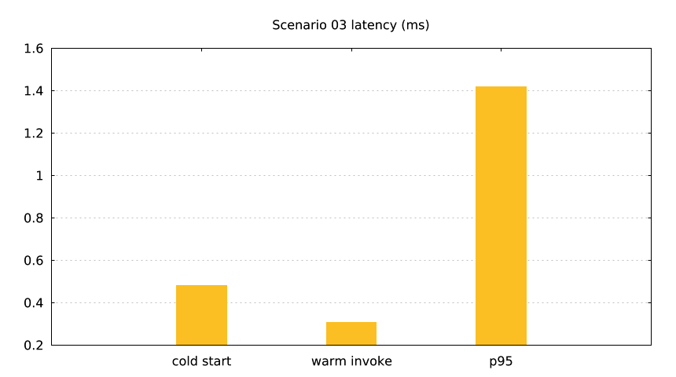

`lmctl all.lms`

`lmctl test.lms`

Offline fake transport provisions a bounded Python Lambda (`python3.12`, 128 MiB, 10 seconds) with the pre-created `lmaws_lambda_exec` role and an explicitly justified public Function URL (`NONE` authentication). The lmcurl test checks JSON shape, cold/warm calls, and p95 latency. Live deployment stays disabled until the role grant is announced.

| Config | Default |
| --- | --- |
| region | `us-east-1` |
| function prefix | `lmaws_` |
| role | `lmaws_lambda_exec` |
| cost | `$0.0000` offline; about `$0.0001` live |

Run each lifecycle command from this directory with `lmctl <file>.lms`; `down.lms` is safe to rerun and proves zero fake leftovers.
