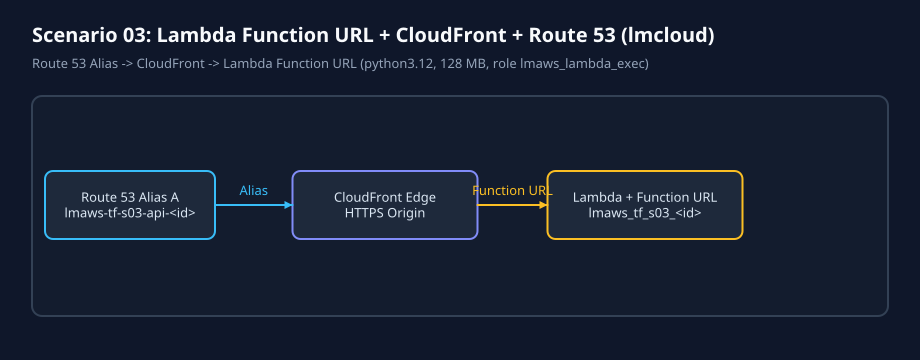
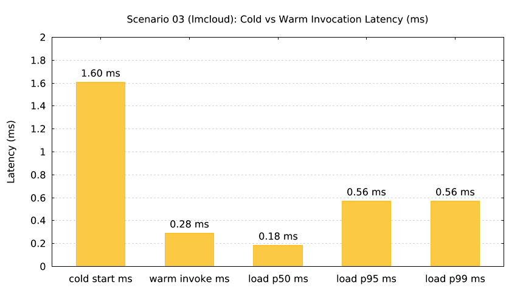

# Scenario 03: Lambda Function URL + CloudFront + Route 53 Alias (`lmcloud`)

`lmctl scenarios/03-lambda-function-url-hello/lmcloud/all.lms`

`lmctl scenarios/03-lambda-function-url-hello/lmcloud/test.lms`

## Overview

Packages [`assets/handler.py`](assets/handler.py) via the embedded `archive` provider (`data.archive_file.fn_zip`) and provisions `aws_lambda_function` (`lmaws_tf_s03_<run_id>`, role `lmaws_lambda_exec`), `aws_cloudwatch_log_group` (`lmaws_tf_s03_logs_<run_id>`), `aws_lambda_function_url` (`authorization_type = "NONE"`), `aws_cloudfront_distribution`, and `aws_route53_record` (`lmaws-tf-s03-api-<run_id>.<domain>`).
