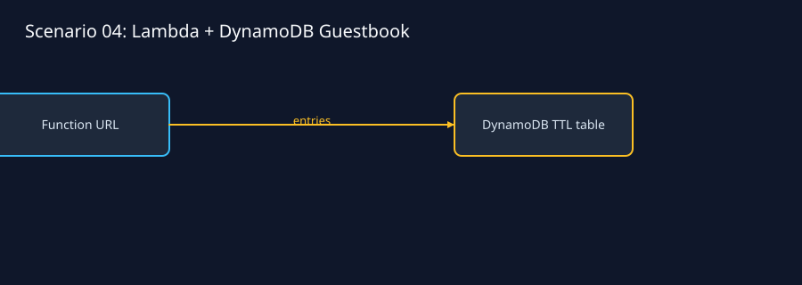
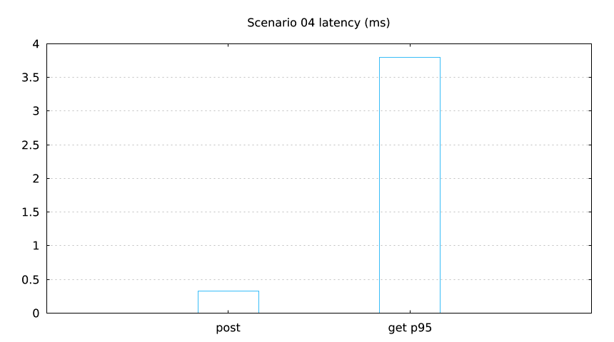

`lmctl scenarios/04-lambda-dynamodb-guestbook/lmaws/all.lms`

Offline fake transport checks a public, explicitly justified Function URL backed by a tagged on-demand DynamoDB table with TTL and cursor-friendly access. The lmcurl test covers POST/GET, bounded pagination, JSON shape and escaping. Live execution waits for the pre-created `lmaws_lambda_exec` role.

Defaults: `us-east-1`, names `lmaws_s04_*`, 128 MiB/10 s, TTL 3600 s, `$0.0000` offline and about `$0.0002` live. Run `lmctl up.lms`, `lmctl test.lms`, `lmctl down.lms` from this directory.
