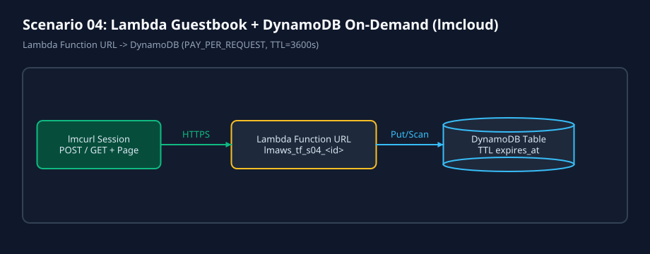
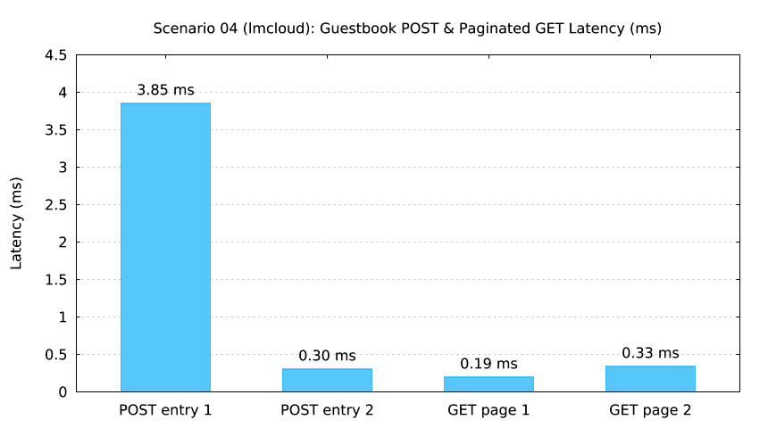

# Scenario 04: Lambda Guestbook + DynamoDB On-Demand (`lmcloud`)



`lmctl scenarios/04-lambda-dynamodb-guestbook/lmcloud/all.lms`



`lmctl scenarios/04-lambda-dynamodb-guestbook/lmcloud/test.lms`

## Overview

Deploys a serverless guestbook API using a Python 3.12 Lambda Function URL (`lmaws_tf_s04_<id>`), a custom CloudWatch Log Group (`lmaws_tf_s04_logs_<id>`), and an on-demand DynamoDB table (`lmaws_tf_s04_entries_<id>`) with Time-To-Live (`expires_at`) enabled.

- **Typical cost**: `$0.0000` offline; `~$0.0002` per live run.
- **Typical time**: `~2.5s` offline; `29.0s` live `up`, `6.1s` live `test`, `33.4s` live `down` (`0` leftovers).

## Live Run Results (`s04r01`, `AWS_PROFILE=lmaws`)

| Metric | Measured Value | Assertion Verified |
| --- | ---: | --- |
| `up.lms` (5 resources: `DynamoDB`, `LogGroup`, `Lambda`, `FunctionURL`, `LambdaPermission`) | `29.02 s` (`29,017 ms`) | `tofu.apply` succeeded under `lmaws_session` v6 + `lmaws_lambda_exec` |
| Cold `GET /?limit=10&offset=0` | `598.31 ms` | `200 OK`, `ttl_attribute == "expires_at"` |
| Warm `GET /?limit=10&offset=0` | `590.70 ms` | `200 OK`, `cold_start == false` |
| `POST /` Entry 1 (XSS payload `<script>alert(1)</script>`) | `660.60 ms` | `201 Created`, HTML-escaped (`&lt;script&gt;alert(1)&lt;/script&gt;`), `expires_at` TTL populated in DynamoDB |
| `POST /` Entry 2 | `491.70 ms` | `201 Created`, persisted in DynamoDB |
| Paginated `GET /?limit=2&offset=0` (Page 1) | `475.29 ms` | `200 OK`, `limit=2`, 2 items returned |
| Paginated `GET /?limit=2&offset=2` (Page 2) | `519.03 ms` | `200 OK`, cursor offset page 2 verified |
| 4-VU `curl.load` (`16` requests) `p50` / `p95` / `p99` | `492.71 ms` / `656.60 ms` / `656.60 ms` | `0.0%` error rate, `p95 < 5000 ms` PASS |
| `down.lms` (`tofu.destroy` `22.93 s` + `lmaws` audit `10.46 s`) | `33.38 s` (`33,384 ms`) | `state_list=""`, post-destroy `plan add=5`, `lmaws` `functions=0`, `tables=0`, `log_groups=0` |

## Commands

```bash
# Offline validation + mock test + diagram/chart ($0.0000)
cd scenarios/04-lambda-dynamodb-guestbook/lmcloud
lmctl all.lms --offline

# Live AWS run (AWS_PROFILE=lmaws only)
AWS_PROFILE=lmaws LMWEBLAB_LIVE=1 LMAWS_LIVE=1 lmctl all.lms --live --run-id s04r01
```
