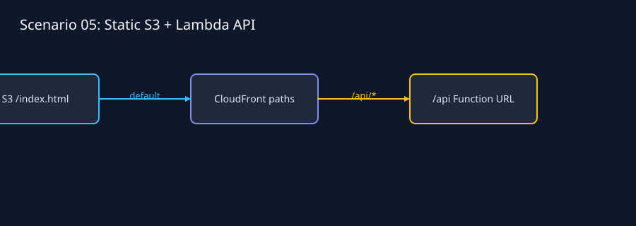
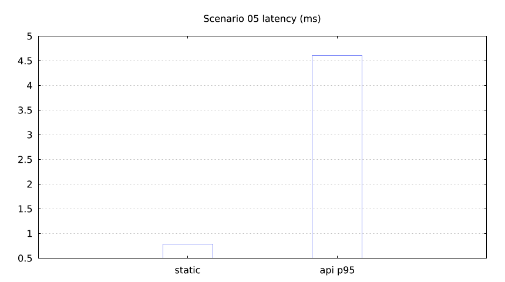

`lmctl all.lms`

`lmctl test.lms`

This fake-transport scenario models one CloudFront hostname with `/` served from a private S3 bucket and `/api/*` sent to a Lambda Function URL. lmcurl asserts both JSON and static responses, cache-safe API behavior, and a bounded p95. Function URL `NONE` authentication is explicit and limited to this test fixture.

Defaults are `us-east-1`, `lmaws-s05-*` names, 128 MiB/10 s, `$0.0000` offline and about `$0.0005` live. Use `lmctl up.lms`, `lmctl test.lms`, `lmctl down.lms`, or `lmctl all.lms`.
