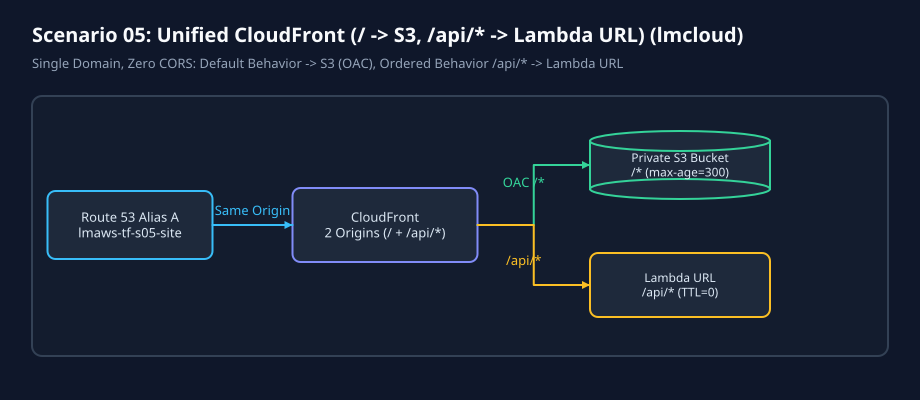
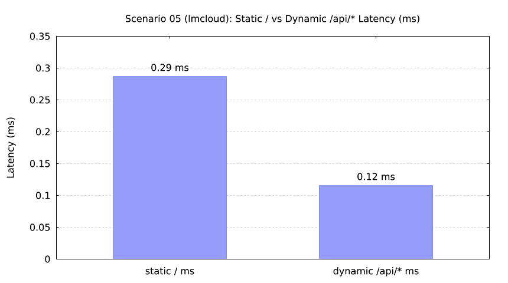

# Scenario 05: Unified CloudFront (`/` -> S3 OAC, `/api/*` -> Lambda Function URL) (`lmcloud`)

`lmctl scenarios/05-static-plus-api/lmcloud/all.lms`

`lmctl scenarios/05-static-plus-api/lmcloud/test.lms`

## Overview

Combines a private S3 static origin (`/*`, cached) and a Python Lambda Function URL origin (`/api/*`, uncached `ordered_cache_behavior`) behind a single CloudFront distribution and Route 53 alias record (`lmaws-tf-s05-site-<run_id>.<domain>`), eliminating cross-origin CORS preflights.
