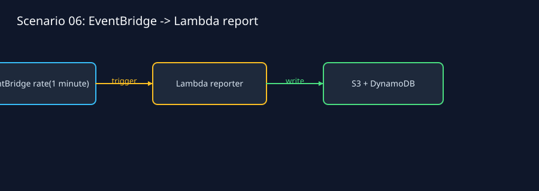
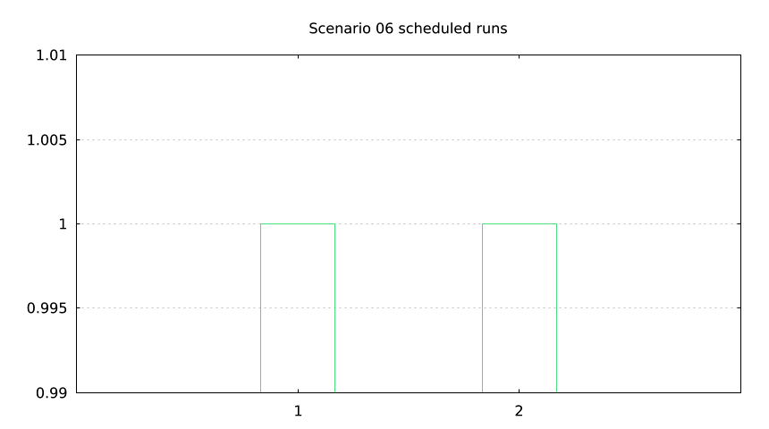

`lmctl all.lms --offline`

# Scheduled report to S3 and DynamoDB: lmaws engine

Live verified using **AWS_PROFILE=lmaws** only. Use a current source-built lmaws containing custom logging and `Serverless.settle`; older release binaries may predate these additions. Run from this directory.

```sh
# Set AWS_PROFILE=lmaws, AWS_REGION=us-east-1 and a fresh hexadecimal LMWEBLAB_RUN_ID.
# Set LMWEBLAB_DOMAIN for scenarios 03 and 05 to the authorized zone.
lmctl all.lms --live
# Inspect individual phases when needed:
lmctl status.lms --live
lmctl down.lms --live
# Offline pictures and handler contracts:
lmctl all.lms --offline
```

All five entry points start with editable CONFIG settings: region/domain, slug, runtime/handler/source, memory, timeout, TTL, schedule, HTTP timeout, load count/window, p95 limit and cost cap. Defaults are python3.12, 128 MiB, 10 seconds, sixteen load requests over at most five seconds, and a $0.05 component cap. The paired web budget remains below the run ceiling. Names and the pre-created role are constrained to the lmaws sandbox.

Measured up/test/cleanup plus checks: **36.2 / 103.6 / 58.9 seconds**. First cold/warm HTTP: **1480.4 / 297.5 ms**; load p95 **1151.2 ms**. Running this example costs about **$0.00378932** under the conservative admitted-bound model; offline charge $0.00. See [results and recovery details](../../RESULTS.md).

Functions use `lmaws_<slug>_logs_<run>`, created/tagged before deployment and deleted after the function. The default log group is never used. AWS log delivery may be delayed; down includes bounded post-delivery settlement, which can add up to ten minutes when run immediately. Exact private creation receipts restrict any late empty-tag repair. Raw state, endpoints, logs, metrics and cost ledgers remain in ignored `.lmweblab-local/`. The role and IAM policy are never modified.

Only scheduled aws.events inputs generate reports. HTTP JSON/HTML reads are read-only. Two scheduled reports, four DynamoDB items, and both S3 objects were verified. Initial pre-schedule reads correctly returned 404.



`lmctl all.lms --offline`

Committed pictures use synthetic fixtures. Final provider-backed audit found **zero leftovers** after the delivery window.
