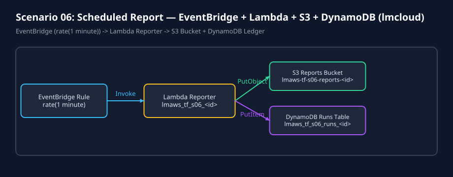
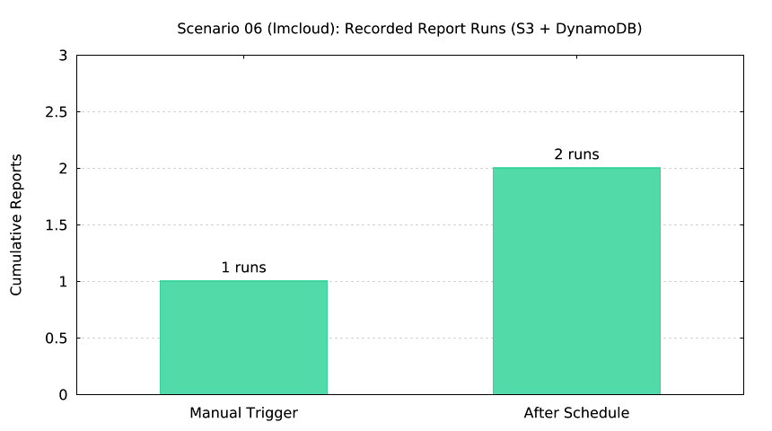

# Scenario 06 (`lmcloud` / OpenTofu): Scheduled Report (`EventBridge` -> `Lambda` -> `S3` + `DynamoDB`)





## Overview

Provisions an EventBridge scheduled rule (`rate(1 minute)`), a Python 3.12 Lambda function (`lmaws_tf_s06_<id>`), a private S3 reports bucket (`lmaws-tf-s06-<id>`), a DynamoDB runs ledger table (`lmaws_tf_s06_runs_<id>`), and a pre-created CloudWatch Log Group (`lmaws_tf_s06_logs_<id>`).

## Commands

```bash
# Offline validation + plan + mock test + plot + diagram
lmctl all.lms --offline

# Live lifecycle (once lmaws_lambda_exec role is available)
AWS_PROFILE=lmaws LMWEBLAB_LIVE=1 lmctl all.lms --live --run-id s06r01
```
