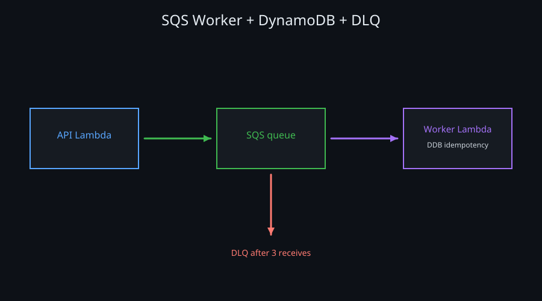
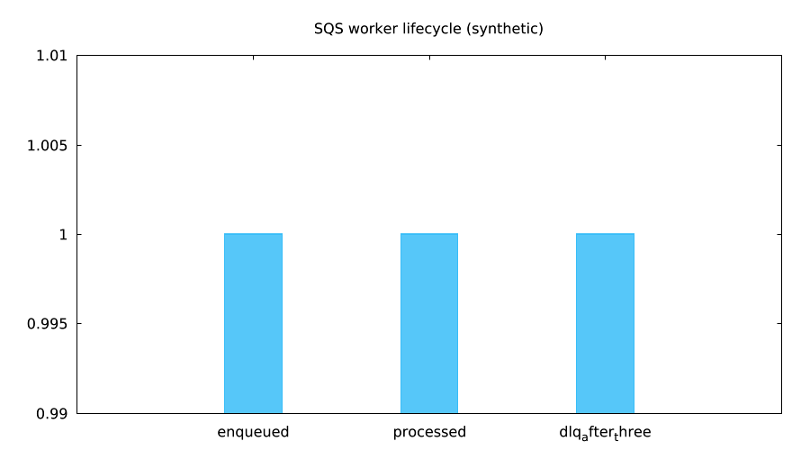

 — `lmctl https://raw.githubusercontent.com/lmctl-ai/lmweblab/main/scenarios/07-sqs-worker/lmaws/report.lms`

 — `lmctl https://raw.githubusercontent.com/lmctl-ai/lmweblab/main/scenarios/07-sqs-worker/lmaws/report.lms`

A Lambda URL enqueues work to an owned SQS queue. A tagged event-source mapping invokes the worker, which writes an idempotent DynamoDB receipt. A poison message fails three source deliveries and is routed to the DLQ. All committed pictures are synthetic.

The live functional tests passed: job completion **6.693 s**, poison-to-DLQ **91.752 s**, API root p95 **458.6 ms**. The initial `all` command failed during a post-delete permission check; cleanup was repaired and a fresh provider audit verified **zero leftovers across both attempts**. No functional test was repeated after the denial.

Running this example costs about **$0.01263188** using the conservative host price table and admitted execution bounds; prices vary by region. The two-attempt campaign including repair/audit was **$0.01268908**, not an invoice. The default cap is $0.05. Offline cost is $0.00.

Run from this directory with a current lmaws main source build on PATH; the released v0.1.19 does not contain the v7b/current worker fixes. Building/testing lmaws creates `target/jvm-bin`, which can be put on PATH. Every lifecycle file exposes CONFIG for region, namespace, prebuilt role, runtime, source, memory, timeout and cap.

```sh
lmctl all.lms --offline
# Only for an explicitly authorized live run:
export AWS_PROFILE=lmaws AWS_REGION=us-east-1
export LMWEBLAB_REMAINING_LIVE_GO=1 LMWEBLAB_WORKER_LIVE_GO=1
RUN_ID=$(python3 -c 'import secrets; print(secrets.token_hex(5))')
lmctl all.lms --live --run-id "$RUN_ID"
```

`up.lms`, `test.lms`, `status.lms` and `down.lms` accept the same mode/run arguments. Up persists mapping creation then waits for Enabled. Mapping tags are only `lmaws_test` at creation; existing mappings are never tagged/adopted. Down removes the mapping before its functions/queues/table, waits for delayed logging using the later function deletion, and independently inventories the run. Raw state, receipts and responses stay in ignored `.lmweblab-local/`.

The denied action was `lambda:GetEventSourceMapping` on `*` during post-delete polling; the mapping was already absent. The client now uses a bounded exact-ARN list lookup for absence while preserving ownership checks for present mappings. Role, IAM and profiles were untouched. [Timings, condition context, failed attempts and cost basis](../../RESULTS.md#scenario-07-sqs-worker-live-tests-and-cleanup-recovery).
