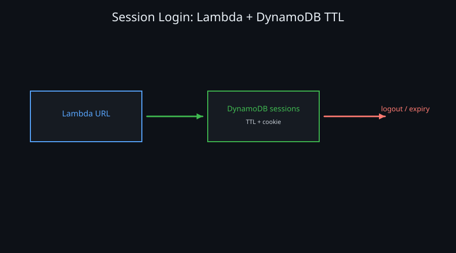
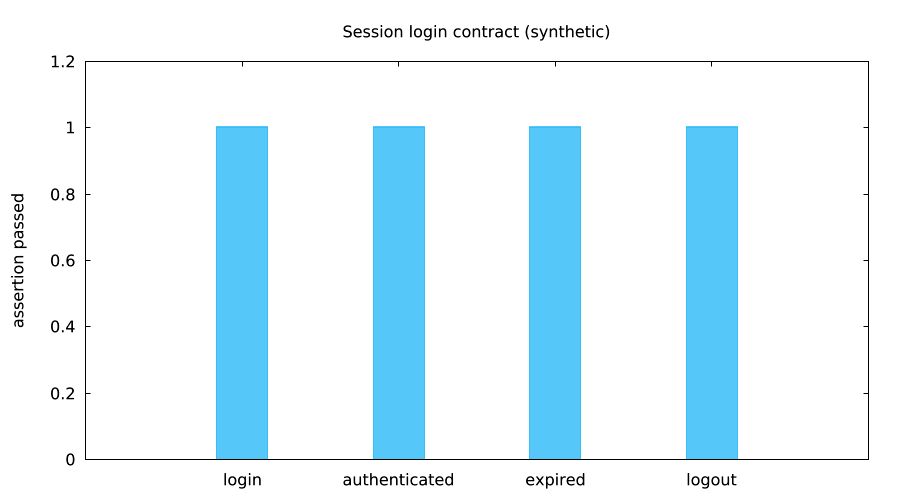

 — `lmctl https://raw.githubusercontent.com/lmctl-ai/lmweblab/main/scenarios/08-session-login-demo/lmaws/report.lms`

 — `lmctl https://raw.githubusercontent.com/lmctl-ai/lmweblab/main/scenarios/08-session-login-demo/lmaws/report.lms`

Run with `lmctl all.lms` (offline fake transport). This scenario exercises a Lambda Function URL backed by a DynamoDB table with a TTL attribute: login issues an HttpOnly cookie, `/me` validates it, logout deletes it, and expiry returns 401. The deployable handler is tested with synthetic transports; live deployment remains pending explicit authorization.

| Config | Default |
| --- | --- |
| region / names | `us-east-1` / `lmaws_` |
| session TTL | `10` seconds |
| role | `lmaws_lambda_exec` |
| cost | `$0.0000` offline; about `$0.0002` live |

Run `lmctl up.lms`, `lmctl test.lms`, and `lmctl down.lms`; teardown is idempotent and records zero fake leftovers. Running this example costs about `$0.0002` live, estimated from the local price table (prices vary by region).

Live validation requires the Lead go (`LMWEBLAB_REMAINING_LIVE_GO=1`), `AWS_PROFILE=lmaws`, a fresh explicit `--run-id`, and a current lmaws source build. No live calls were made here. See [IAM coverage](../../IAM_REMAINING.md). All runtime state stays in ignored `.lmweblab-local/`; `all.lms` attempts down after errors, and down can be repeated.

For a later authorized live run, set a private `LMWEBLAB_DEMO_PASSWORD` of at least 12 characters. Empty/unset/unknown credentials fail closed. The ephemeral login form is demonstration code, with HttpOnly/Secure/SameSite cookies and logical TTL expiry; it is not a production identity system. Live expiry tests require TTL_SECONDS 1..30 (default 10).
