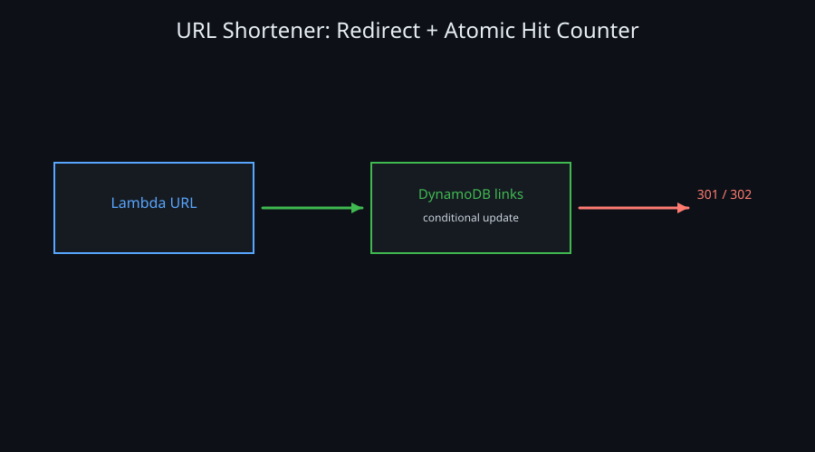
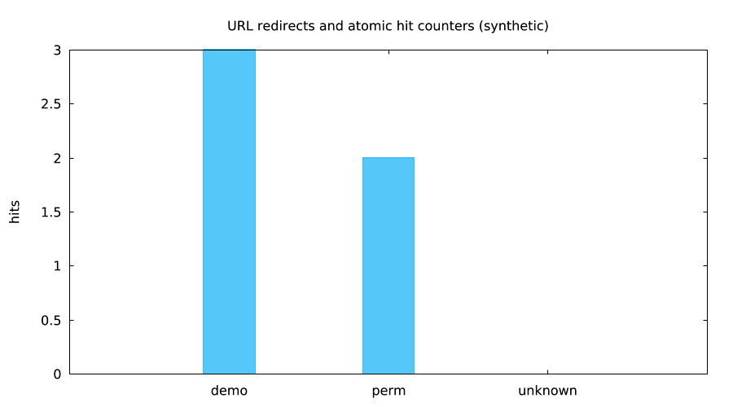

 — `lmctl https://raw.githubusercontent.com/lmctl-ai/lmweblab/main/scenarios/09-url-shortener/lmaws/report.lms`

 — `lmctl https://raw.githubusercontent.com/lmctl-ai/lmweblab/main/scenarios/09-url-shortener/lmaws/report.lms`

Run with `lmctl all.lms` (offline fake transport). The Lambda URL resolves named short codes from a DynamoDB table, performs conditional hit-count updates, returns 302 or 301 redirects, and returns 404 for unknown codes. The deployed handler also passed the authorized live campaign; public pictures remain synthetic.

| Config | Default |
| --- | --- |
| region / names | `us-east-1` / `lmaws_` |
| redirect fixtures | `demo` (302), `perm` (301) |
| role | `lmaws_lambda_exec` |
| cost | `$0.0000` offline; about `$0.00325006` live |

Run `lmctl up.lms`, `lmctl test.lms`, and `lmctl down.lms`; teardown is idempotent and records zero fake leftovers. Running this example costs about `$0.00325006` live, estimated from the local price table (prices vary by region).

Live validation requires the Lead go (`LMWEBLAB_REMAINING_LIVE_GO=1`), `AWS_PROFILE=lmaws`, a fresh explicit `--run-id`, and a current lmaws source build. See [IAM coverage](../../IAM_REMAINING.md). All runtime state stays in ignored `.lmweblab-local/`; `all.lms` attempts down after errors, and down can be repeated.

Live verification (profile `lmaws` only): **26.6 s up / 11.2 s test / 619.5 s down**, p95 **391.8 ms**, **zero leftovers**. Running this example costs about **$0.00325006**, conservatively estimated from the run ledger and price table; prices vary by region, and this is not an invoice. Down includes log settlement where Lambda is used. [Timings, failed attempts and cost basis](../../RESULTS.md#remaining-lmaws-scenarios-live-verification).
