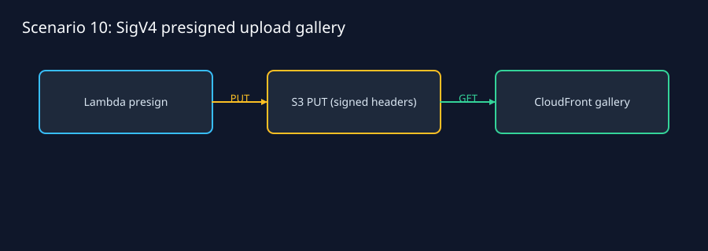
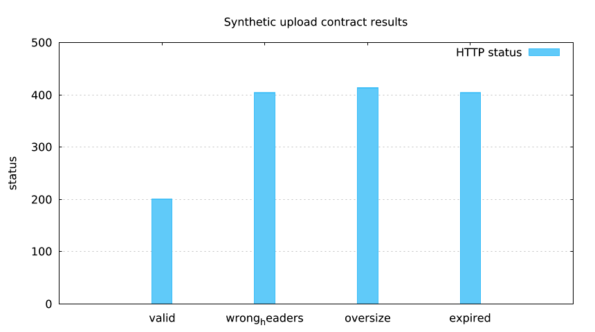

Run: `lmctl https://raw.githubusercontent.com/lmctl-ai/lmweblab/main/scenarios/10-presigned-upload-gallery/lmaws/all.lms --offline`

# Presigned upload gallery — lmaws

The Lambda handler issues SigV4 PUT URLs for one private run-owned S3 bucket. Content type and exact content length are signed, expiry is at most 900 seconds, and this scenario caps uploads at 1 MiB. CloudFront OAC serves the upload bucket with bounded static caching. Signing a MIME header does not validate image bytes or generate thumbnails; uploaded images are the gallery objects.

Regenerate: `lmctl https://raw.githubusercontent.com/lmctl-ai/lmweblab/main/scenarios/10-presigned-upload-gallery/lmaws/report.lms`

CONFIG includes REGION, DOMAIN, NAME_PREFIX, SLUG, prebuilt ROLE, RUNTIME, HANDLER, SOURCE_FILE, MEMORY_MB, TIMEOUT_S, TTL_SECONDS, MAX_UPLOAD_BYTES, CONTENT_TYPES, UPLOAD_EXPIRY_SECONDS, CACHE_SECONDS and COST_CAP_USD. All five lifecycle entry points accept `--offline` and `--run-id`. Start with `lmctl all.lms --offline`, or run up/test/status/down individually.

Offline lmcurl obtains a synthetic grant, uploads the bytes through its returned URL, fetches the exact stored bytes, and rejects changed content type, changed length, oversized signing requests and expired grants. These are synthetic bound/expiry tests, separate from the lmaws SDK loopback SigV4 signature test. They do not prove live S3 or CloudFront propagation. Every resource plan carries the run tag; all guarantees of zero leftovers here are simulated. `all.lms` attempts teardown even on failure, then independently audits the run. Live runs require the later Lead go, `LMWEBLAB_REMAINING_LIVE_GO=1`, profile lmaws and a fresh explicit --run-id.

Running this example costs about **$0.00 offline**, or **$0.0005 estimated live** for a short Lambda/S3/CloudFront run. Estimates use the host price table and HTTP request/transfer bounds; prices vary by region and are not live measurements. Expected deployment is minutes live due to CloudFront; offline is seconds.

The upload expiry defaults to 10 seconds; the live expiry test accepts at most 30 seconds to stay bounded. The configured scenario cap is divided between the Serverless and Web journals. Public pictures are synthetic; future live retrieval tests use CloudFront, while the offline retrieval uses the loopback object store.
