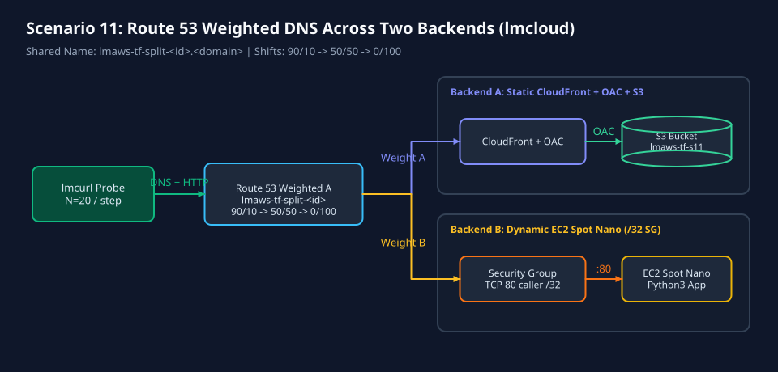
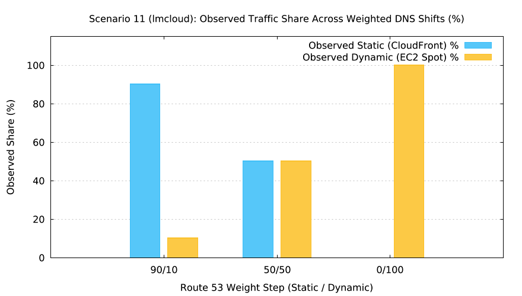

# Scenario 11: Route 53 Weighted DNS Across Two Backends (`lmcloud`)



`lmctl scenarios/11-weighted-dns-two-backends/lmcloud/all.lms`



`lmctl scenarios/11-weighted-dns-two-backends/lmcloud/test.lms`

## Overview

Deploys two real backends behind a single shared DNS name (`lmaws-tf-split-<run_id>.<domain>`) using Route 53 **weighted `A` records** (`SetIdentifier` + `Weight`):
- **Backend A (`backend-a-static`)**: Private S3 static site fronted by CloudFront Origin Access Control (OAC SigV4), returning `"lmweblab Static Site"`.
- **Backend B (`backend-b-dynamic`)**: One-time EC2 Spot `t4g.nano` dynamic Python 3 HTTP server guarded by a `/32` security group, returning `"lmweblab Dynamic App"`.

`test.lms` shifts the Route 53 weights through **`90/10` -> `50/50` -> `0/100`** via `tofu.apply`, queries `N = 20` independent samples per step using fresh RFC 7871 `edns_client_subnet` DoH lookups paired with `lmcurl` `.resolve()`, asserts the observed traffic split is within binomial confidence bounds, and renders the observed split chart via `lmplot`.

- **Typical cost**: `$0.0000` offline; `~$0.0040` per live run.
- **Typical time**: `10.0s` offline; `502.3s` live `up`, `107.1s` live 3-step shift + test, `284.7s` live `down` (`0` leftovers).

## Live Run Results (`s11r01`, `AWS_PROFILE=lmaws`, `N = 20` per step)

| Step | Target Weights (Static / Dynamic) | Elapsed (`tofu.apply` + Probes) | Static Hits (CloudFront) | Dynamic Hits (EC2 Spot) | Observed Split (Static % / Dynamic %) | Binomial Confidence Band (`N = 20`) |
| ---: | --- | ---: | ---: | ---: | ---: | --- |
| 1 | `90 / 10` | `4.42 s` | `17 / 20` | `3 / 20` | **`85% / 15%`** | Static in `[65%, 100%]` (PASS) |
| 2 | `50 / 50` | `51.06 s` | `7 / 20` | `13 / 20` | **`35% / 65%`** | Static in `[25%, 75%]` (PASS) |
| 3 | `0 / 100` | `51.11 s` | `0 / 20` | `20 / 20` | **`0% / 100%`** | Static in `[0%, 5%]` (PASS) |

## Configuration Constants (`# === CONFIG ===`)

| Constant | Default | Purpose |
| --- | --- | --- |
| `REGION` | `"us-east-1"` | Target AWS region |
| `DOMAIN` | `getenv("LMWEBLAB_DOMAIN", "example.com")` | Route 53 hosted zone domain |
| `NAME_PREFIX` | `"lmaws"` | Mandatory resource naming prefix |
| `SCENARIO_SLUG` | `"s11"` | Scenario identifier in resource names |
| `STEP1_STATIC_WEIGHT` / `STEP1_DYNAMIC_WEIGHT` | `90` / `10` | Initial traffic split (Static / Dynamic) |
| `STEP2_STATIC_WEIGHT` / `STEP2_DYNAMIC_WEIGHT` | `50` / `50` | Equal traffic split |
| `STEP3_STATIC_WEIGHT` / `STEP3_DYNAMIC_WEIGHT` | `0` / `100` | Full cutover to Dynamic backend |
| `SAMPLES_PER_STEP` | `20` | Requests per weight step |
| `BINOMIAL_TOLERANCE_PCT` | `"35.0"` | Binomial confidence tolerance (%) for `N=20` |

## Commands

```bash
# Offline validation + mock split check + diagram/chart generation ($0.0000)
cd scenarios/11-weighted-dns-two-backends/lmcloud
lmctl all.lms

# Live AWS run (AWS_PROFILE=lmaws only)
AWS_PROFILE=lmaws LMWEBLAB_DOMAIN=example.com LMWEBLAB_LIVE=1 LMAWS_LIVE=1 lmctl all.lms --live --run-id s11r01
```
