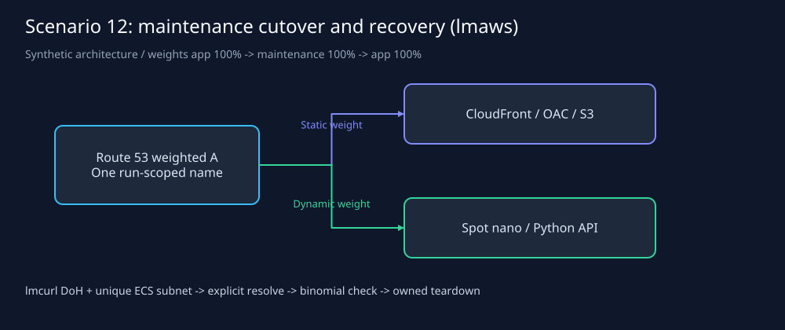
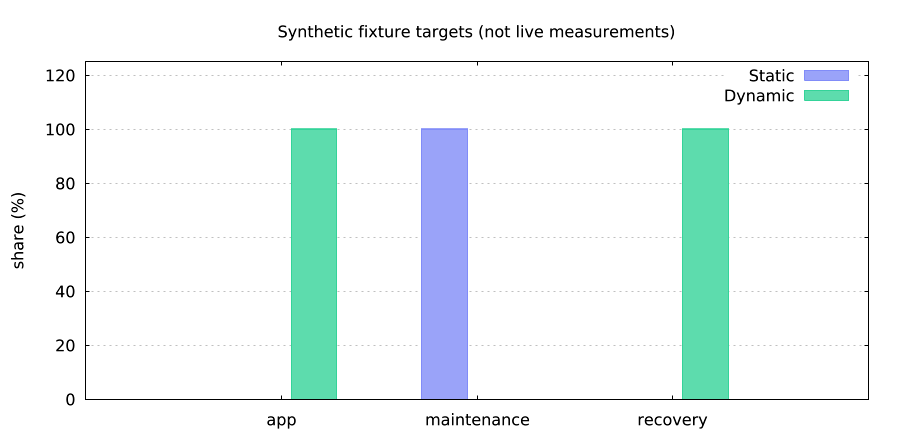

Run this picture and the lifecycle: `lmctl https://raw.githubusercontent.com/lmctl-ai/lmweblab/main/scenarios/12-maintenance-page-failover/lmaws/all.lms --offline`

# Maintenance page cutover — lmaws

A tagged Spot nano serves the application. A private S3 maintenance page uses CloudFront OAC. Two owned Route 53 weighted A records implement a manual all-or-nothing cutover: app 100% → maintenance 100% → app 100%. This reuses the catalog's bounded weighted-record engine; it does not provision paid health checks or claim automatic failure detection.



Regenerate: `lmctl https://raw.githubusercontent.com/lmctl-ai/lmweblab/main/scenarios/12-maintenance-page-failover/lmaws/report.lms`

CONFIG at the top of each entry point sets REGION, DOMAIN, NAME_PREFIX, INSTANCE_TYPE, HTTP timeout, sample count, the three static weights (0/100/0), cost cap and HTTPS. The static maintenance assets live in `assets/site/`. Runtime state, provider identifiers and receipts stay in ignored `.lmweblab-local/`.

```sh
lmctl up.lms --offline
lmctl test.lms --offline
lmctl status.lms --offline
lmctl down.lms --offline
lmctl all.lms --offline
```

The lmcurl contract checks both origin pages, then 20 fixture HTTP responses at each endpoint weight, plus independent simulated zero-leftover discovery. Live DNS tests use DoH and explicit resolution to distinguish backends. They send the CloudFront hostname as Host; this proves DNS/backend selection, not a production browser TLS failover contract. DNS caches can delay cutover. A separate production design would need its own cache/availability and HTTPS acceptance criteria.

Running this example costs about **$0.00 offline**, or **$0.0040 estimated live** for a short Spot nano/S3/CloudFront run, using the existing price table and admitted HTTP bound. Prices vary; no new live measurements were made. Local offline lifecycle takes about 40 seconds on this machine. `all.lms` always attempts down after either phase fails; down is repeatable and verifies zero simulated leftovers. Live up/test/all require the Lead go (`LMWEBLAB_REMAINING_LIVE_GO=1`), profile lmaws, a fresh run id and an authorized domain. No live calls were made here.
